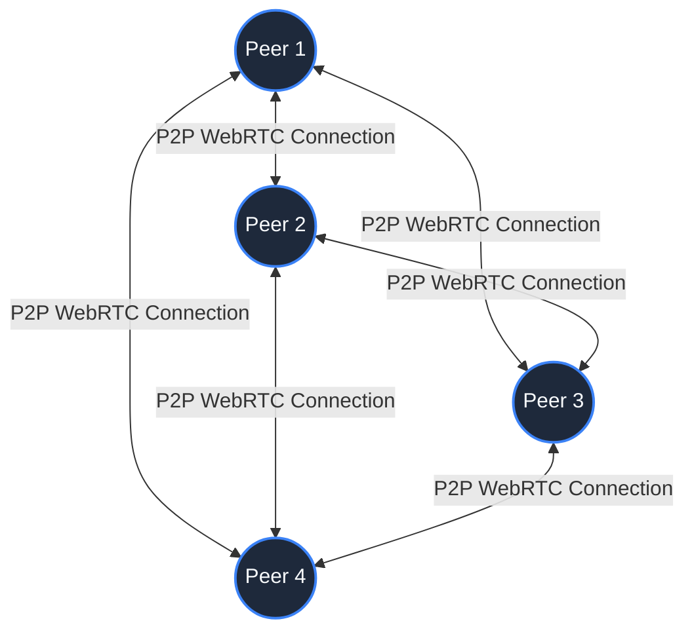
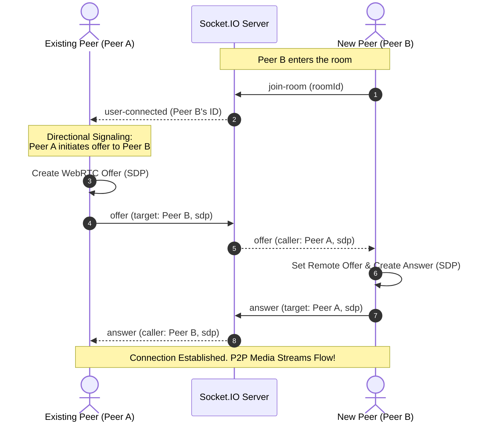

# 🌐 MeshMeet - Multi-Peer WebRTC Video Chat Application

MeshMeet is a high-performance, containerized, multi-peer video conferencing application built with **Next.js**, **TypeScript**, and **WebRTC**. It features a custom **Socket.IO** signaling server to establish direct, ultra-low-latency peer-to-peer (P2P) connections in a fully connected mesh topology.

---

## 🎥 Project Demo

[](https://youtu.be/H4L81-wvtCA)

---

## 🚀 Key Features

*   **P2P Video & Audio**: Real-time media streaming directly between browser clients using raw WebRTC `RTCPeerConnection` APIs.
*   **Fully Connected Mesh Topology (up to 4 Peers)**: Every client establishes direct connections to all other participants.
*   **State-of-the-Art Signaling Server**: A custom Next.js Socket.IO server designed with a flat event listener structure to avoid memory leaks.
*   **Glare Prevention**: A strict directional signaling design where only existing room participants initiate offers to new joiners.
*   **In-Call Media Controls**: Full control over camera toggle, microphone mute, and clean call hangup with automatic resource cleanup.
*   **Live Text Chat**: Shared real-time room chat powered by WebSocket relaying.
*   **React Strict Mode Safety**: Asynchronous connection cancellation to prevent ghost connections in development.
*   **Docker Containerized**: Out-of-the-box container setup with automated health checking.

---

## 💼 Real-World Use Cases

The decentralized, low-latency, and zero-server-overhead nature of MeshMeet makes it ideal for several modern streaming and collaboration use cases:

*   **Virtual Boardrooms & Standups**: Perfect for small team daily standups (up to 4-6 users) without incurring expensive cloud media processing or relay hosting fees.
*   **Telehealth & Private Consultations**: Direct P2P WebRTC media connections provide maximum privacy since audio/video streams go directly client-to-client and do not route through a central media server.
*   **Remote Classroom Study Groups**: Provides low-latency audio, video, and real-time text chat for small collaborative learning teams.
*   **Customer Support & Live Consulting**: Can be easily integrated into e-commerce or SaaS sites to connect support agents directly to customers in real-time.

---

## 📐 Architecture & Flow

### 1. Mesh Topology Network (K4 Complete Graph)
In a mesh topology, there is no media server (SFU/MCU). Every peer acts as a server to every other peer by sending their media track directly.



### 2. Signaling Flow (Offer/Answer Negotiation)
WebRTC peers cannot discover each other automatically. They exchange connection metadata (SDP) and network routing paths (ICE Candidates) through our signaling server.



---

## 🛠️ Tech Stack & Technologies

*   **Frontend**: Next.js 14 (App Router), React 18, Tailwind CSS, TypeScript.
*   **Real-time Protocol**: Socket.IO (WebSockets) for metadata exchange.
*   **P2P Protocol**: WebRTC API (`RTCPeerConnection`, `MediaStream`, `RTCIceCandidate`).
*   **Infrastructure**: Docker, Docker Compose, Node.js.

---

## 💻 Setup & Installation

### Prerequisites
*   Docker & Docker Compose installed on your system.
*   A webcam and microphone (or virtual devices) for browser media testing.

### Environment Configuration
Copy the `.env.example` file to create a local environment file:
```bash
cp .env.example .env
```
Ensure the environment contains the variables:
*   `PORT=3000`
*   `NEXT_PUBLIC_STUN_SERVER=stun:stun.l.google.com:19302` (STUN server for public NAT traversal).

### Running inside Docker
To build and start all containerized services:
```bash
docker-compose up --build -d
```
*   The application will be accessible at: `http://localhost:3000`
*   Docker Compose monitors container health via the `/api/health` endpoint.

### Running for Development (Local Machine)
1. Install dependencies:
   ```bash
   npm install
   ```
2. Run the server using hot-reloading:
   ```bash
   npm run dev
   ```
3. Open `http://localhost:3000` in your web browser.

---

## 📝 Key Design Considerations & Hacks

### 1. Preventing WebRTC Glare via Directional Signaling
WebRTC Glare occurs when two peers try to send an offer to each other simultaneously, leading to state conflicts. MeshMeet prevents this by enforcing a rule: **only existing room participants generate offers for new joiners**. The new joiner remains purely reactive, listening for offers and responding with answers.

### 2. Preventing State-Sync Overhead using React `useRef`
React state updates are asynchronous and trigger re-renders. Storing heavy, mutable objects like `RTCPeerConnection` or `MediaStream` in component state would trigger infinite loop renders or performance degradation. We store these connections in a mutable `useRef` map and only use state to update the UI on critical milestones (e.g., when a track is successfully added or when a user leaves).

### 3. Strict Mode Guard against Ghost Connections
React Strict Mode runs effects twice in development. When component mounts, media queries run asynchronously. We implemented an `active` cancellation flag in the `useEffect` cleanup handler. If the component unmounts before media resolves, we cancel socket initialization and stop the media tracks immediately, preventing duplicate ghost loops.
